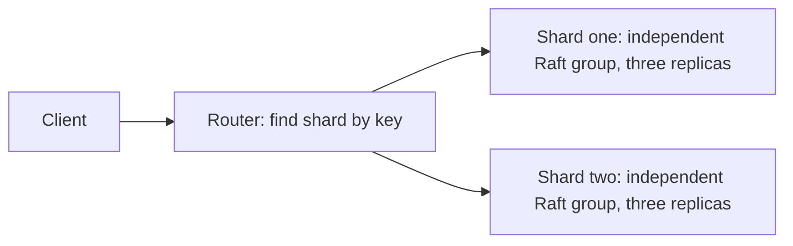

# From a Raft Prototype to a Scalable, Deliverable, Maintainable System

Learning path: master the system locally before considering cloud servers. At
each stage, first define the problem to solve, then write the code, and finally
verify the result with repeatable checks.

## What the Three Goals Address

| Goal | Plain-language explanation | Capabilities to add |
|---|---|---|
| Scalability | As business grows, open more service counters that actually share the work | Sharding, multiple Raft groups, request routing, load and capacity experiments |
| CI: continuous integration | Automatically check every submission for regressions | Compilation, protocol tests, process-failure checks |
| Delivery | After checks pass, produce a runnable artifact with an identifiable version | JAR/image artifacts, version and build records |
| Deployment | Run that artifact in a specified environment | Environment configuration, startup, verification, failure handling |
| DevOps | Make testing, delivery, operation, observation, and maintenance a reliable workflow | Automation, logs, metrics, data persistence, deployment and recovery |

The current additions establish a foundation for CI and local delivery and
verification. Docker, monitoring, sharding, and automatic deployment remain later
stages. Writing a few scripts does not mean all these goals are complete.

## Why Three Replicas Do Not Yet Demonstrate Scalability

Each of the three current nodes stores all the data. They are like three people
each copying the same ledger, primarily so the ledger remains available when one
person leaves.

Sharing more data and write requests requires two groups to handle different
ledgers, with each group still keeping three copies. A router uses the key to
decide which group should receive each request.

The following structure is planned for a later stage. The current code does not
yet include sharding or a router:



Each group would then store only some of the keys, and their leaders could handle
different requests. Whether this is faster must be measured with matching data
sizes, read/write ratios, concurrency, warmup, and file-forcing settings. A single
group of three processes and two groups totaling six processes use different resources,
which the test report must state clearly. Running everything on one computer
also creates contention for the same disk, so doubled performance cannot be
guaranteed in advance.

Dynamic expansion also requires migration: after adding a group, some existing
keys must move. Writes during migration, routing changes, and failure recovery
all need a design. Start with two fixed groups, then learn migration with writes
paused, and finally consider online migration.

## Staged Learning and Acceptance Checks

| Stage | Work to do | How to verify completion | Skills involved |
|---|---|---|---|
| 1: starting point for this revision | Package a JAR, start three independent processes, and automatically check failure recovery | Writes still succeed after forcibly terminating the leader; after restart, original and new data agree across all three persisted states | Java engineering, testing, CI, recovery |
| 2: runtime environment | Dockerfile, Compose, data volumes, health checks, restart operations | A new environment starts successfully; data survives container recreation | Containerization, deployment, DevOps |
| 3: observation and measurement | Request volume, errors, latency, election and catch-up progress | Explain what keeps the service busy and where it is slow | Observability, performance analysis |
| 4: versions and deployment | Automatically deliver versioned packages/images, then connect a defined local deployment environment | Automatically check a specified version after deployment; provide clear failure-handling steps | Delivery, deployment |
| 5: sharing the work | Two fixed Raft groups, sharding rules, a router | Each group receives different keys, and replicas within each group agree | Sharding, scalable systems |
| 6: demonstrating the scaling effect | Compare one group and two groups under a fixed workload | Report data distribution, throughput, latency, errors, and resource conditions together | Benchmarking, system design |
| 7: moving data during expansion | Data migration and routing changes | Data remains complete after migration, and failures are recoverable | Rebalancing, system evolution |

Later features will be implemented stage by stage, without introducing every
tool in the first lesson.

## Lesson One: What One Command Does

Run from the project root:

```bash
bash scripts/verify.sh
```

Read this script first. It has only three main jobs:

```text
Run the existing 23 regression checks
          ↓
Package the program as build/dist/raftkv.jar
          ↓
Start three independent JVMs from that same JAR and check forced termination and recovery
```

A JAR is a package containing the program files. Running it still requires Java;
it does not include an entire operating system and Java runtime. The Docker stage
will address runtime-environment consistency.

### Packaging the Artifact

`scripts/package.sh` does two things:

1. Compile with `javac --release 17` to constrain the minimum bytecode and
   standard-library API version.
2. Use `jar` to package the class files and specify `NodeMain` as the server entry
   point.

The following command only builds the package:

```bash
bash scripts/package.sh
```

Artifact path: `build/dist/raftkv.jar`.

### Verifying the Artifact

By default, `scripts/process-smoke.sh` compiles first and then runs the check tool.
`verify.sh` specifies `RAFTKV_CLASSPATH=build/dist/raftkv.jar`, so the check tool
and all three child processes use the newly packaged JAR instead of a separate
set of class files.

Check sequence:

1. Start three independent Java processes, each with a different port and data
   directory.
2. Save, read, update, and delete data over real HTTP, and retain several known
   reference values.
3. Use `destroyForcibly()` to terminate the current leader process forcibly.
4. Wait for the remaining majority to elect a new leader, write another 25
   records, and wait for the snapshot to advance beyond the old leader's progress.
5. Restart the killed node with its original data directory, then compare the
   complete data, applied progress, and snapshot progress in all three persisted
   states.
6. Automatically stop the remaining child processes when the check ends.

After DELETE, GET and the final data state verify that the key is absent. This
avoids incorrectly treating a successful first deletion whose response was lost,
followed by a retry returning null, as an error. The current system still does
not provide exactly-once request deduplication.

Local logs and data remain in `work/process-smoke-*`. On failure, the terminal
reports which directory contains each node's stdout/stderr. The check uses its own
temporary directory and does not delete data from clusters previously started
manually.

This checks process termination and restart, not physical power loss or arbitrary
network partitions.

## How the Same Commands Support CI and Delivery

After a push or PR, `.github/workflows/test.yml` prepares the Java environment,
calls the same `verify.sh`, and then runs the existing short benchmark. Local and
CI runs therefore use the same verification entry point.

`.github/workflows/delivery.yml` verifies and delivers the JAR after a manual
trigger or a pushed `v*` tag. The downloadable artifact's name includes the source
commit identifier, and failures prevent the artifact-upload step. This workflow
does not deploy the service; automatic deployment will be studied separately
after a runtime environment is selected.

GitHub's [Java workflow guide](https://docs.github.com/en/actions/tutorials/build-and-test-code/java-with-maven)
also demonstrates the flow of running build/test commands and then uploading
build artifacts. This project retains pure-JDK scripts; using Actions does not
require switching to Maven first.

The current workflows are local configuration. Confirming successful execution
on GitHub requires actually pushing and reviewing the run results. Master the
local flow first, then verify the hosted workflows.

The next lesson covers [Docker Compose](https://docs.docker.com/compose/): define
services, networks, and data volumes in one configuration to make startup and
shutdown easier to repeat.
