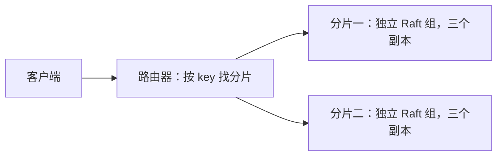

# 从 Raft 原型走向可扩展、可交付、可维护的系统

学习路线：先在本机掌握，再考虑云服务器。每个阶段都先明确要解决的问题，
再写代码，最后用可重复的检查验证结果。

## 三个目标分别解决什么问题

| 目标 | 最通俗的理解 | 要增加的能力 |
|---|---|---|
| Scalability，可扩展性 | 生意变多了，多开几个真正分担工作的柜台 | 分片、多组 Raft、请求路由、负载与容量实验 |
| CI，持续集成 | 每次交作业，都自动检查有没有改坏东西 | 编译、协议测试、进程故障检查 |
| Delivery，交付 | 检查通过后，得到一份可以运行、可以识别版本的成品 | JAR/镜像产物、版本与构建记录 |
| Deployment，部署 | 把这一份成品放到指定环境运行 | 环境配置、启动、验证、失败处理 |
| DevOps | 让测试、交付、运行、观察和维护形成可靠流程 | 自动化、日志、指标、数据保存、部署与恢复 |

目前新增的是 CI 和本机交付/验证基础。Docker、监控、分片和自动部署仍是后续阶段，
不能把已经写好几个脚本等同于已经完成全部目标。

## 为什么三个副本还不能说明可以扩容

现在三个节点各保存全部数据。它们像三个人各抄一份相同的账本，
主要目的是其中一个人离开时，账本仍然可用。

要分摊更多数据和写请求，需要让两组人分别负责不同的账，每组内部仍保存三份。
路由器根据 key 决定请求应该交给哪一组。

下面是后续准备实现的结构，当前代码尚未包含分片或路由器：



这时每组只保存一部分 key，各自的主节点可以处理不同请求。
是否更快，需要用相同数据大小、读写比例、并发、预热和刷盘配置来测量。
单组三进程与双组六进程使用了不同的资源，测试报告要写清楚；
都在同一台电脑上运行也会争用同一块磁盘，不能预先保证性能翻倍。

动态扩容还需要迁移：新增一组后，有些旧 key 要搬家。
迁移期间的新写入、路由切换和失败恢复都需要设计。
因此先做固定两组，再学暂停写入的迁移，最后考虑在线迁移。

## 分阶段的学习与验收

| 阶段 | 要做的事情 | 怎样知道做成了 | 对应能力 |
|---|---|---|---|
| 1：本轮起点 | 打包 JAR，启动三个独立进程，自动检查故障恢复 | 强杀主节点后仍能写，重启后原数据与新增数据在三份持久化状态中一致 | Java 工程、测试、CI、恢复 |
| 2：运行环境 | Dockerfile、Compose、数据卷、健康检查、重启操作 | 新环境可以启动；重建容器后数据仍在 | 容器化、部署、DevOps |
| 3：观察与测量 | 请求量、错误、延迟、选主和追赶进度 | 能解释服务在忙什么、慢在哪里 | Observability、性能分析 |
| 4：版本与部署 | 自动交付版本包/镜像，再接明确的本机部署环境 | 部署指定版本后自动检查；失败有明确处理步骤 | Delivery、Deployment |
| 5：分摊工作 | 固定两组 Raft、分片规则、路由器 | 两组分别接收不同 key，组内副本一致 | Sharding、Scalable Systems |
| 6：证明扩展效果 | 固定工作负载，对比单组和双组 | 同时报告数据分布、吞吐、延迟、错误和资源条件 | Benchmarking、System Design |
| 7：扩容搬家 | 数据迁移与路由切换 | 迁移后数据完整，失败后可恢复 | Rebalancing、系统演进 |

后面的功能会按阶段逐步实现，不在第一节同时引入全部工具。

## 第一节：一条命令发生了什么

在项目根目录运行：

```bash
bash scripts/verify.sh
```

先读这个脚本，它只有三项主要工作：

```text
运行已有的 23 项回归测试
          ↓
将程序打包成 build/dist/raftkv.jar
          ↓
使用同一个 JAR 启动三个独立 JVM，检查强杀和恢复
```

JAR 可以理解成装好程序文件的包。运行它仍然需要 Java；
它没有把整个操作系统和 Java 运行环境一起装进去。
Docker 阶段会继续解决运行环境的一致性。

### 包装成品

`scripts/package.sh` 做两件事：

1. 用 `javac --release 17` 编译，限制字节码和标准库 API 的最低版本。
2. 用 `jar` 把类文件装进一个包，并指定服务器入口 `NodeMain`。

下面的命令只负责打包：

```bash
bash scripts/package.sh
```

成品路径：`build/dist/raftkv.jar`。

### 验证成品

`scripts/process-smoke.sh` 默认先编译，再执行检查工具；
`verify.sh` 会指定 `RAFTKV_CLASSPATH=build/dist/raftkv.jar`，
使检查工具和三个子进程都使用刚打包的 JAR，而不是另一份类文件。

检查流程：

1. 启动三个独立 Java 进程，每个进程使用不同端口和数据目录。
2. 经真实 HTTP 保存、读取、修改、删除数据，并保存几个已知的参考值。
3. 用 `destroyForcibly()` 强制结束当时的主节点进程。
4. 等剩余多数重新选主，继续写入 25 条数据，并等待快照越过旧主节点的进度。
5. 用原数据目录重启被杀节点，核对三份持久化状态的完整数据、执行进度和快照进度。
6. 检查结束时自动关闭剩余子进程。

DELETE 之后通过 GET 和最终数据状态检查“这个键确实不存在”。
这样不会把“第一次删除成功但响应丢失，重试返回空值”误判为错误；
当前系统仍不提供 exactly-once 请求去重。

本机运行日志和数据保留在 `work/process-smoke-*`。
遇到失败，终端会告诉你去哪个目录查每个节点的 stdout/stderr。
检查使用单独临时目录，不删除之前手动启动集群的数据。

这是进程终止与重启检查，不是物理断电，也不是任意网络分区检查。

## 同一套命令怎样进入 CI 和交付

`.github/workflows/test.yml` 在 push/PR 后，准备 Java 环境并调用同一个 `verify.sh`，
再运行已有短基准。这样本机和 CI 使用相同的验收入口。

`.github/workflows/delivery.yml` 在手动触发或推送 `v*` 标签后验证并交付 JAR。
下载产物名称包含源码提交标识，失败时不会进入上传成品步骤。
这个工作流不部署服务；自动部署会在选定运行环境后单独学习。

GitHub 的[Java 工作流说明](https://docs.github.com/en/actions/tutorials/build-and-test-code/java-with-maven)
也展示了“调用构建/测试命令，再上传构建产物”的流程；本项目保留纯 JDK 脚本，
不需要为了使用 Actions 先改成 Maven。

当前工作流是本地配置，是否在 GitHub 成功执行，需要实际推送和查看运行结果。
先掌握本机流程，再验证托管工作流。

下一节将学习 [Docker Compose](https://docs.docker.com/compose/)：
把服务、网络和数据卷写到一份配置里，让启动和停止更容易重复。
